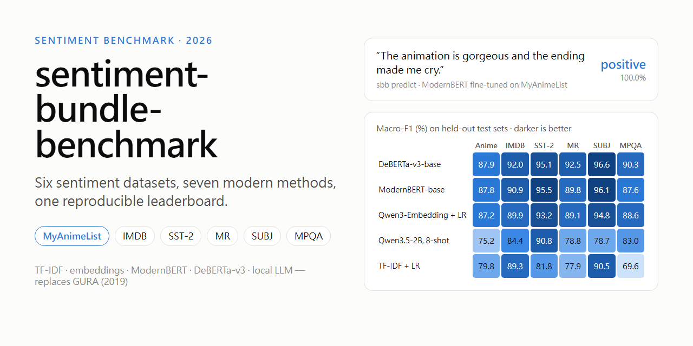
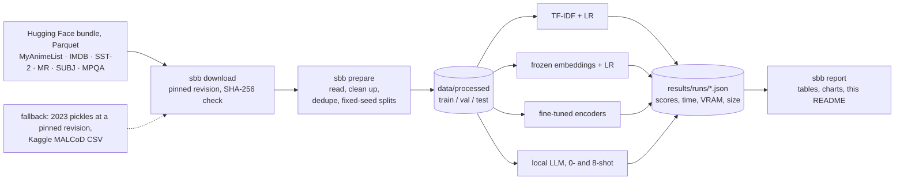
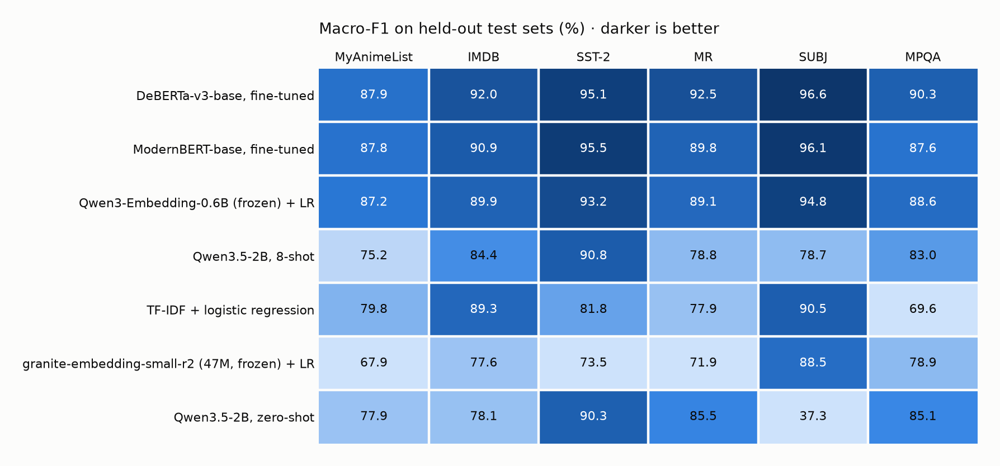
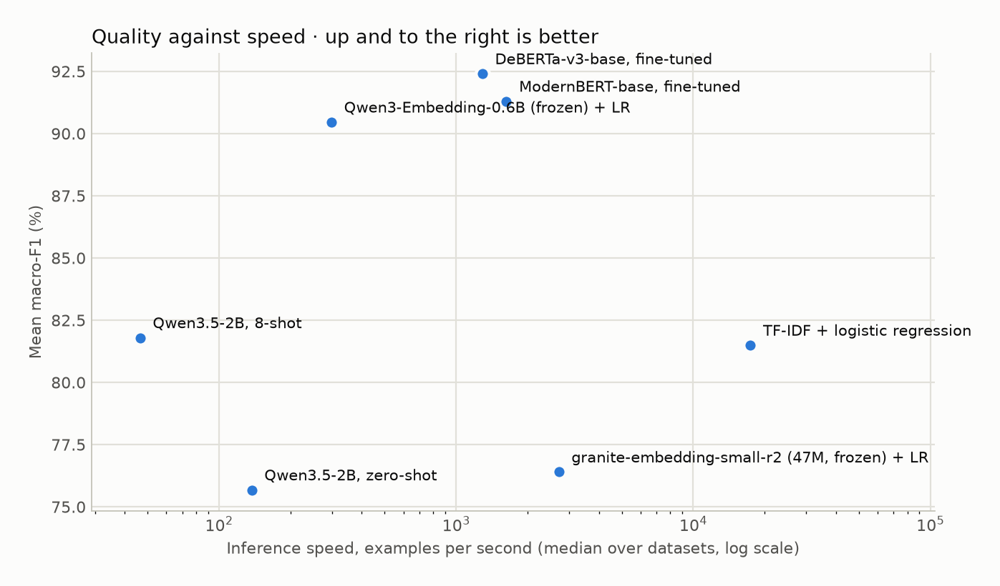
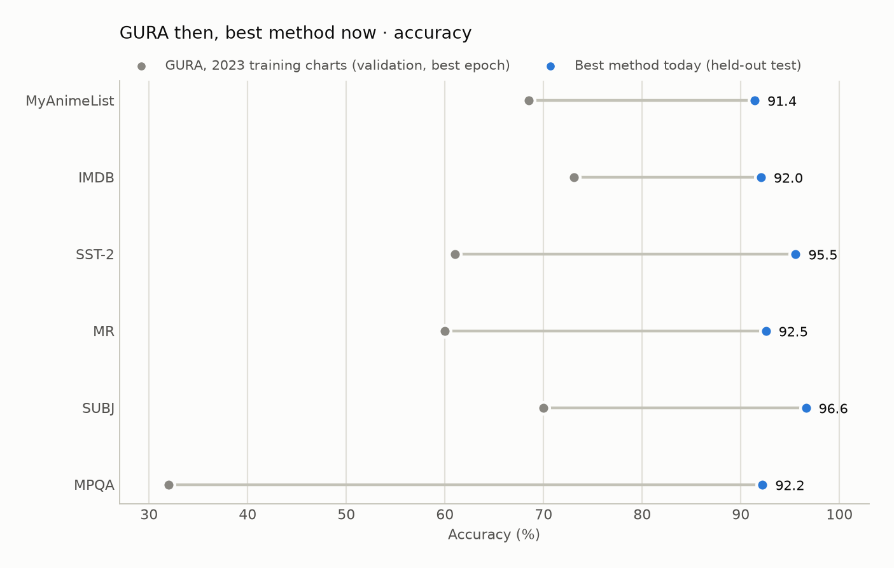

# sentiment-bundle-benchmark

<p align="center">
  
</p>

[](https://github.com/NatLee/sentiment-bundle-benchmark/actions/workflows/ci.yml)

[](LICENSE)
[](https://huggingface.co/datasets/NatLee/sentiment-classification-dataset-bundle)
[](https://www.kaggle.com/datasets/natlee/myanimelist-comment-dataset)

A small, honest, reproducible benchmark of how you would classify sentiment *today* on six English
datasets: 135K MyAnimeList anime reviews ([MALCoD](https://www.kaggle.com/datasets/natlee/myanimelist-comment-dataset))
plus the five classic sets in the
[sentiment-classification-dataset-bundle](https://huggingface.co/datasets/NatLee/sentiment-classification-dataset-bundle)
(IMDB, SST-2, MR, SUBJ, MPQA). It compares a TF-IDF baseline, frozen sentence embeddings, fine-tuned
encoders (ModernBERT, DeBERTa-v3) and a 2B local LLM prompted zero- and few-shot, all on the same fixed
splits with fixed seeds, and reports accuracy, macro-F1, training time, speed, VRAM and model size.

It replaces [GURA](https://github.com/NatLee/gura-gru-unit-for-recognizing-affect), the 2019 BiGRU +
attention model that was written to introduce these datasets. Its numbers are kept below as history.

## Contents

- [The datasets](#the-datasets)
- [The methods](#the-methods)
- [How the pipeline works](#how-the-pipeline-works)
- [Results](#results)
- [What changed since 2019](#what-changed-since-2019)
- [Quick start](#quick-start)
- [Reproducing the numbers](#reproducing-the-numbers)
- [Notes on the data](#notes-on-the-data)
- [Should the fine-tuned models go on the Hugging Face Hub?](#should-the-fine-tuned-models-go-on-the-hugging-face-hub)
- [Development](#development)
- [Citations and licences](#citations-and-licences)

## The datasets

| Dataset | One example is | Labels | Train / val / test used here | Source |
|---|---|---|---:|---|
| **MyAnimeList** (MALCoD) | a full anime review, 2006-2019 | negative (rating 1-5) / positive (6-10) | 25,000 / 2,000 / 5,000 | bundle, from [MALCoD](https://www.kaggle.com/datasets/natlee/myanimelist-comment-dataset) |
| **IMDB** (aclImdb) | a movie review | negative / positive | 22,901 / 2,000 / 5,000 | [bundle](https://huggingface.co/datasets/NatLee/sentiment-classification-dataset-bundle) |
| **SST-2** | a movie-review sentence or phrase | negative / positive | 25,000 / 872 / 1,819 | bundle |
| **MR** | a Rotten Tomatoes snippet | negative / positive | 7,677 / 853 / 2,132 | bundle |
| **SUBJ** | a movie sentence | subjective / objective | 7,200 / 800 / 2,000 | bundle |
| **MPQA** | a short opinion phrase from the news | negative / positive | 5,863 / 651 / 1,628 | bundle |

MyAnimeList is the dataset GURA was built to show off. The benchmark splits it by time: reviews posted
before 2018 are the training pool, reviews from 2018-2019 are the test pool, so the models are always
judged on reviews written after the ones they learned from. About 81% of the reviews are positive,
which is why every table reports macro-F1 next to accuracy.

Big sets are subsampled (stratified, seed 42) to 25,000 training and 5,000 test examples so the whole
benchmark fits in about three GPU-hours. The exact rows are fingerprinted in
[`results/splits.json`](results/splits.json). See [Notes on the data](#notes-on-the-data) for the
cleaning rules and the problems found in the original files.

## The methods

| Method | What it does | Why it is here |
|---|---|---|
| TF-IDF + logistic regression | word and bigram counts, linear model, CPU only | the classic baseline every result should beat |
| [granite-embedding-small-english-r2](https://huggingface.co/ibm-granite/granite-embedding-small-english-r2) + LR | 47M-parameter embedding model, frozen, linear model on top | the cheapest "neural" option |
| [Qwen3-Embedding-0.6B](https://huggingface.co/Qwen/Qwen3-Embedding-0.6B) + LR | strong small open embedding model, frozen, with a task instruction | best quality per GB among small embedding models in late 2026 |
| [ModernBERT-base](https://huggingface.co/answerdotai/ModernBERT-base), fine-tuned | 150M encoder, 2 epochs, best epoch picked on validation | the 2024 refresh of BERT: fast, long context |
| [DeBERTa-v3-base](https://huggingface.co/microsoft/deberta-v3-base), fine-tuned | 184M encoder, same recipe | still the accuracy reference for base-size encoders |
| [Qwen3.5-2B](https://huggingface.co/Qwen/Qwen3.5-2B), zero-shot | a local 2B instruction model reads the text and picks a label word | no training data at all |
| Qwen3.5-2B, 8-shot | the same model with 8 labelled examples (4 per class) in the prompt | the cheapest way to "teach" an LLM |

All models are open (Apache-2.0 or MIT), ungated and pinned to a Hub commit in
[`configs/benchmark.toml`](configs/benchmark.toml). The LLM never generates text: the prompt ends where
the answer starts and the label whose first token is more likely wins, which is deterministic and fast.

## How the pipeline works



Every method sees exactly the same rows. Validation data is only used to pick hyper-parameters
(the regularisation strength C, the best fine-tuning epoch); the test split is touched once, at the end.

## Results

Measured on one RTX 4080 (16 GB) shared with other jobs, bf16, seed 42. "Training" is fine-tuning for
the encoders and encoding the train and validation text plus fitting the logistic regression for the
embedding methods; the LLM has none. Speeds include tokenisation and are noisy on a shared machine, so
treat them as orders of magnitude. Everything between here and the next section is generated by
`sbb report --readme README.md`.

<!-- results:start -->
### Leaderboard: macro-F1 on the held-out test splits (%)

Bold marks the best score per dataset. Macro-F1 averages the F1 of both classes, so a model cannot look good by always guessing the bigger class.

| Method | MyAnimeList | IMDB | SST-2 | MR | SUBJ | MPQA | Mean |
| --- | ---: | ---: | ---: | ---: | ---: | ---: | ---: |
| DeBERTa-v3-base, fine-tuned | **87.9** | **92.0** | 95.1 | **92.5** | **96.6** | **90.3** | 92.4 |
| ModernBERT-base, fine-tuned | 87.8 | 90.9 | **95.5** | 89.8 | 96.1 | 87.6 | 91.3 |
| Qwen3-Embedding-0.6B (frozen) + LR | 87.2 | 89.9 | 93.2 | 89.1 | 94.8 | 88.6 | 90.5 |
| Qwen3.5-2B, 8-shot | 75.2 | 84.4 | 90.8 | 78.8 | 78.7 | 83.0 | 81.8 |
| TF-IDF + logistic regression | 79.8 | 89.3 | 81.8 | 77.9 | 90.5 | 69.6 | 81.5 |
| granite-embedding-small-r2 (47M, frozen) + LR | 67.9 | 77.6 | 73.5 | 71.9 | 88.5 | 78.9 | 76.4 |
| Qwen3.5-2B, zero-shot | 77.9 | 78.1 | 90.3 | 85.5 | 37.3 | 85.1 | 75.7 |

<picture>
  <source media="(prefers-color-scheme: dark)" srcset="docs/images/leaderboard-dark.png">
  
</picture>

### Accuracy (%)

| Method | MyAnimeList | IMDB | SST-2 | MR | SUBJ | MPQA | Mean |
| --- | ---: | ---: | ---: | ---: | ---: | ---: | ---: |
| DeBERTa-v3-base, fine-tuned | **91.4** | **92.0** | 95.1 | **92.5** | **96.6** | **92.2** | 93.3 |
| ModernBERT-base, fine-tuned | 91.3 | 90.9 | **95.5** | 89.8 | 96.2 | 90.1 | 92.3 |
| Qwen3-Embedding-0.6B (frozen) + LR | 90.8 | 89.9 | 93.2 | 89.1 | 94.8 | 90.9 | 91.5 |
| Qwen3.5-2B, 8-shot | 77.6 | 84.4 | 90.8 | 79.5 | 78.7 | 84.8 | 82.6 |
| TF-IDF + logistic regression | 86.9 | 89.3 | 81.9 | 77.9 | 90.5 | 78.0 | 84.1 |
| granite-embedding-small-r2 (47M, frozen) + LR | 80.7 | 77.6 | 73.6 | 71.9 | 88.5 | 83.8 | 79.3 |
| Qwen3.5-2B, zero-shot | 80.6 | 78.7 | 90.3 | 85.5 | 51.8 | 88.0 | 79.2 |

### What it costs

| Method | Parameters | Training (all sets) | Inference, examples/s (median) | Peak VRAM |
| --- | ---: | ---: | ---: | ---: |
| DeBERTa-v3-base, fine-tuned | 184.4M | 34.2 min | 1,289 | 7.4 GB |
| ModernBERT-base, fine-tuned | 149.6M | 25.0 min | 1,629 | 6.9 GB |
| Qwen3-Embedding-0.6B (frozen) + LR | 595.8M | 10.2 min | 298 | 3.3 GB |
| Qwen3.5-2B, 8-shot | 1.9B | none | 46 | 5.1 GB |
| TF-IDF + logistic regression | 200K | 1.9 min | 17,420 | CPU only |
| granite-embedding-small-r2 (47M, frozen) + LR | 47.7M | 1.4 min | 2,709 | 0.6 GB |
| Qwen3.5-2B, zero-shot | 1.9B | none | 137 | 5.0 GB |

<picture>
  <source media="(prefers-color-scheme: dark)" srcset="docs/images/speed-vs-quality-dark.png">
  
</picture>

### GURA, for the record

GURA (2019, BiGRU + self-attention on GloVe vectors, Keras) is kept here as history, not as a competitor. Its numbers are validation accuracy at the best epoch, on validation sets that mixed in the test split, after re-training until a target was hit, so they are optimistic and not comparable with the held-out test scores above. The 2019 claim comes from a commit message; the 2023 values are read off the training charts in GURA's README (about one point of reading error). The MyAnimeList column used the summarised `myanimelist-sts` text, not the full reviews.

| Dataset | GURA 2019 claim | GURA 2023 charts | Best now, test accuracy |
| --- | ---: | ---: | --- |
| MyAnimeList | – | ≈ 68 | 91.4 (DeBERTa-v3-base, fine-tuned) |
| IMDB | 89.1 | ≈ 73 | 92.0 (DeBERTa-v3-base, fine-tuned) |
| SST-2 | – | ≈ 61 | 95.5 (ModernBERT-base, fine-tuned) |
| MR | – | ≈ 60 | 92.5 (DeBERTa-v3-base, fine-tuned) |
| SUBJ | – | ≈ 70 | 96.6 (DeBERTa-v3-base, fine-tuned) |
| MPQA | – | ≈ 32 | 92.2 (DeBERTa-v3-base, fine-tuned) |

<picture>
  <source media="(prefers-color-scheme: dark)" srcset="docs/images/gura-then-now-dark.png">
  
</picture>

### Per-dataset breakdown

#### MyAnimeList reviews (MALCoD)

25,000 train / 2,000 val / 5,000 test; labels: negative / positive.

| Method | Accuracy | Macro-F1 | 95% CI (F1) | Training | Examples/s |
| --- | ---: | ---: | ---: | ---: | ---: |
| DeBERTa-v3-base, fine-tuned | 91.4 | 87.9 | 86.8–89.0 | 15.1 min | 238 |
| ModernBERT-base, fine-tuned | 91.3 | 87.8 | 86.5–88.9 | 10.3 min | 177 |
| Qwen3-Embedding-0.6B (frozen) + LR | 90.8 | 87.2 | 86.0–88.3 | 5.1 min | 82 |
| TF-IDF + logistic regression | 86.9 | 79.8 | 78.5–81.2 | 1.4 min | 822 |
| Qwen3.5-2B, zero-shot | 80.6 | 77.9 | 76.6–79.0 | none | 33 |
| Qwen3.5-2B, 8-shot | 77.6 | 75.2 | 73.9–76.3 | none | 11 |
| granite-embedding-small-r2 (47M, frozen) + LR | 80.7 | 67.9 | 66.2–69.5 | 46 s | 621 |

#### IMDB movie reviews (aclImdb)

22,901 train / 2,000 val / 5,000 test; labels: negative / positive.

| Method | Accuracy | Macro-F1 | 95% CI (F1) | Training | Examples/s |
| --- | ---: | ---: | ---: | ---: | ---: |
| DeBERTa-v3-base, fine-tuned | 92.0 | 92.0 | 91.3–92.8 | 6.3 min | 831 |
| ModernBERT-base, fine-tuned | 90.9 | 90.9 | 90.1–91.7 | 6.4 min | 383 |
| Qwen3-Embedding-0.6B (frozen) + LR | 89.9 | 89.9 | 89.1–90.7 | 2.2 min | 200 |
| TF-IDF + logistic regression | 89.3 | 89.3 | 88.5–90.1 | 26 s | 2,984 |
| Qwen3.5-2B, 8-shot | 84.4 | 84.4 | 83.4–85.3 | none | 15 |
| Qwen3.5-2B, zero-shot | 78.7 | 78.1 | 76.9–79.2 | none | 86 |
| granite-embedding-small-r2 (47M, frozen) + LR | 77.6 | 77.6 | 76.5–78.8 | 19 s | 1,646 |

#### Stanford Sentiment Treebank, binary (SST-2)

25,000 train / 872 val / 1,819 test; labels: negative / positive.

| Method | Accuracy | Macro-F1 | 95% CI (F1) | Training | Examples/s |
| --- | ---: | ---: | ---: | ---: | ---: |
| ModernBERT-base, fine-tuned | 95.5 | 95.5 | 94.6–96.4 | 4.8 min | 2,022 |
| DeBERTa-v3-base, fine-tuned | 95.1 | 95.1 | 94.1–96.0 | 6.0 min | 1,749 |
| Qwen3-Embedding-0.6B (frozen) + LR | 93.2 | 93.2 | 92.1–94.3 | 1.6 min | 289 |
| Qwen3.5-2B, 8-shot | 90.8 | 90.8 | 89.6–92.1 | none | 66 |
| Qwen3.5-2B, zero-shot | 90.3 | 90.3 | 88.9–91.6 | none | 203 |
| TF-IDF + logistic regression | 81.9 | 81.8 | 80.0–83.5 | 2 s | 18,924 |
| granite-embedding-small-r2 (47M, frozen) + LR | 73.6 | 73.5 | 71.5–75.6 | 9 s | 2,493 |

#### Movie Review sentence polarity (MR)

7,677 train / 853 val / 2,132 test; labels: negative / positive.

| Method | Accuracy | Macro-F1 | 95% CI (F1) | Training | Examples/s |
| --- | ---: | ---: | ---: | ---: | ---: |
| DeBERTa-v3-base, fine-tuned | 92.5 | 92.5 | 91.4–93.6 | 1.8 min | 1,748 |
| ModernBERT-base, fine-tuned | 89.8 | 89.8 | 88.5–91.0 | 1.1 min | 2,633 |
| Qwen3-Embedding-0.6B (frozen) + LR | 89.1 | 89.1 | 87.9–90.4 | 21 s | 754 |
| Qwen3.5-2B, zero-shot | 85.5 | 85.5 | 84.0–86.9 | none | 204 |
| Qwen3.5-2B, 8-shot | 79.5 | 78.8 | 77.2–80.5 | none | 53 |
| TF-IDF + logistic regression | 77.9 | 77.9 | 76.1–79.7 | 1 s | 22,524 |
| granite-embedding-small-r2 (47M, frozen) + LR | 71.9 | 71.9 | 70.0–73.7 | 3 s | 3,153 |

#### Subjectivity (SUBJ)

7,200 train / 800 val / 2,000 test; labels: subjective / objective.

| Method | Accuracy | Macro-F1 | 95% CI (F1) | Training | Examples/s |
| --- | ---: | ---: | ---: | ---: | ---: |
| DeBERTa-v3-base, fine-tuned | 96.6 | 96.6 | 95.7–97.4 | 1.7 min | 1,777 |
| ModernBERT-base, fine-tuned | 96.2 | 96.1 | 95.2–96.9 | 57 s | 2,548 |
| Qwen3-Embedding-0.6B (frozen) + LR | 94.8 | 94.8 | 93.7–95.7 | 26 s | 306 |
| TF-IDF + logistic regression | 90.5 | 90.5 | 89.1–91.7 | 2 s | 15,917 |
| granite-embedding-small-r2 (47M, frozen) + LR | 88.5 | 88.5 | 87.2–89.8 | 3 s | 2,925 |
| Qwen3.5-2B, 8-shot | 78.7 | 78.7 | 76.9–80.4 | none | 40 |
| Qwen3.5-2B, zero-shot | 51.8 | 37.3 | 35.8–39.0 | none | 183 |

#### MPQA opinion polarity

5,863 train / 651 val / 1,628 test; labels: negative / positive.

| Method | Accuracy | Macro-F1 | 95% CI (F1) | Training | Examples/s |
| --- | ---: | ---: | ---: | ---: | ---: |
| DeBERTa-v3-base, fine-tuned | 92.2 | 90.3 | 88.7–91.8 | 3.3 min | 521 |
| Qwen3-Embedding-0.6B (frozen) + LR | 90.9 | 88.6 | 86.8–90.3 | 26 s | 372 |
| ModernBERT-base, fine-tuned | 90.1 | 87.6 | 85.8–89.4 | 1.4 min | 1,236 |
| Qwen3.5-2B, zero-shot | 88.0 | 85.1 | 83.1–87.0 | none | 92 |
| Qwen3.5-2B, 8-shot | 84.8 | 83.0 | 80.9–84.9 | none | 64 |
| granite-embedding-small-r2 (47M, frozen) + LR | 83.8 | 78.9 | 76.5–81.1 | 2 s | 3,055 |
| TF-IDF + logistic regression | 78.0 | 69.6 | 67.1–72.3 | 0 s | 54,548 |
<!-- results:end -->

## What changed since 2019

GURA was a reasonable 2019 recipe: GloVe word vectors, a bidirectional GRU, self-attention on top.
Seven years later, the same datasets tell a fairly clear story.

- **Fine-tune a pretrained encoder if you have labels.** DeBERTa-v3-base (2021) and ModernBERT-base
  (2024) top every dataset, with a mean macro-F1 of 92.4 and 91.3. DeBERTa is ahead on the short-text sets
  (MR, MPQA) by about 2.7 points; ModernBERT is level on MyAnimeList, within about a point on IMDB,
  wins SST-2, trains faster and fits twice the batch in the same memory.
- **Frozen embeddings are the cheap runner-up.** Qwen3-Embedding-0.6B plus a logistic regression lands
  within two points of fine-tuning (90.5 mean) and within a point on MyAnimeList, with no GPU training at all:
  you only pay for encoding the text once. Size matters here, though: the 47M granite model scores below
  TF-IDF, because a small general-purpose embedding does not keep much sentiment.
- **TF-IDF is still a real baseline.** On long reviews it is hard to beat cheaply: 89.3 on IMDB in half a
  minute of CPU, which already beats GURA's best IMDB claim on a fairer test.
- **A 2B local LLM is the zero-data option, not the best one.** With no examples at all, Qwen3.5-2B gets
  90.3 on SST-2 and 85.5 on MR. But it is poorly calibrated: it called 917 of 3,808 positive anime reviews
  negative, and on SUBJ it answered "subjective" for 98% of the sentences (macro-F1 37.3). Eight examples
  in the prompt fix SUBJ (78.7) but hurt MR and MyAnimeList, and the long prompts make it the slowest
  method here (about 46 examples per second). It is what you use before you have labels.
- **Evaluation got stricter.** Each method sees one fixed test split once, macro-F1 sits next to
  accuracy because MyAnimeList is 81% positive, and every score has a bootstrap interval. Re-running
  ModernBERT on IMDB with the same seed moved it by 0.7 points (GPU kernels are not deterministic), so
  gaps under about one point between fine-tuned models are noise.

What made GURA's own numbers misleading, for the record:

- The validation data included the official test split, the best epoch was kept, and `command.py`
  re-trained until the validation accuracy beat a target. The reported number was the luckiest of many
  tries on data the model was tuned against.
- The stop-word list removed *not*, *no*, *never* and *nothing*, so "not good" and "good" looked the same.
- The 2023 tokenizer kept only the 100 most frequent words.
- Half of the IMDB training set was generated word salad, and the MyAnimeList labels were misaligned
  with their text (see below). GURA's 68.5% on MyAnimeList is below the 83% you get by always answering
  "positive" on its own validation set.

## Quick start

You need Docker with GPU support (or a Python 3.11+ environment with PyTorch) and about 15 GB of disk
for the models.

```bash
git clone https://github.com/NatLee/sentiment-bundle-benchmark.git
cd sentiment-bundle-benchmark
docker build -t sentiment-bundle-benchmark .

# One alias so the commands below stay short. The named volume keeps downloaded models between runs.
alias sbb='docker run --rm --gpus all --memory 10g -v "$PWD:/app" -v sbb-hfcache:/cache/huggingface -w /app sentiment-bundle-benchmark'

sbb download                         # about 240 MB of Parquet into data/raw, checked by SHA-256
sbb prepare                          # fixed splits into data/processed, fingerprints into results/splits.json
sbb run --methods tfidf-logreg       # one method on all six datasets, a few minutes on CPU
sbb run                              # everything that has no result yet (about 3 GPU-hours)
sbb report --readme README.md        # tables, charts and the block above
```

Without Docker: `pip install -c constraints.txt ".[models]"` and use the `sbb` command directly.
`sbb --help` and `sbb <command> --help` list every option; `sbb list` shows the dataset and method names.

### Label your own text

Keep the fine-tuned models with `--save-models`, then ask one of them:

```bash
sbb run --methods modernbert-base-ft --datasets myanimelist --force --save-models models
sbb predict --model-dir models/modernbert-base-ft/myanimelist \
  "The animation is gorgeous and the ending made me cry." \
  "Twelve episodes of nothing happening. I want my weekend back."
```

```text
positive   100.0%  The animation is gorgeous and the ending made me cry.
negative    97.6%  Twelve episodes of nothing happening. I want my weekend back.
```

## Reproducing the numbers

- Splits, caps and the seed live in [`configs/benchmark.toml`](configs/benchmark.toml); the resulting row
  ids are fingerprinted per split in [`results/splits.json`](results/splits.json). If `sbb prepare`
  gives the same `ids_sha256`, you have the same rows.
- Every run writes one JSON file to `results/runs/<method>/<dataset>.json` with the scores, a bootstrap
  95% interval, the confusion matrix, timings, peak VRAM, parameter count, the method settings and the
  library versions. A finished run is skipped next time; use `--force` to redo it.
- Exact library versions are in [`constraints.txt`](constraints.txt); the Docker image starts from
  `pytorch/pytorch:2.14.1-cuda13.2-cudnn9-runtime`.
- GPU kernels are not bit-for-bit deterministic. Re-running ModernBERT on IMDB with the same seed moved
  its macro-F1 from 91.6 to 90.9, so read gaps under about a point between fine-tuned models as noise.
- Timings come from a GPU and CPU shared with other jobs. The first ModernBERT IMDB run took 15.6 minutes
  while two other containers held the GPU, the re-run 6.4 minutes; the table keeps the re-run.

## Notes on the data

Re-reading the 2023 bundle for this benchmark turned up three problems, and the bundle was rebuilt as
Parquet in November 2026 to fix them. `sbb download` fetches the Parquet files. The loaders still
read the 2023 files (pinned to their revision in [`configs/benchmark.toml`](configs/benchmark.toml)) and
both give exactly the same rows, so the split fingerprints in `results/splits.json` hold either way.

- **The 2023 files were Python pickles.** A pickle can run arbitrary code while it loads, and the Hugging
  Face viewer cannot show it. The rebuilt bundle is plain Parquet. For the old files, the loader only
  accepts the nine pandas/numpy names they actually use
  ([`safe_pickle.py`](src/sentiment_bundle_benchmark/safe_pickle.py)) and refuses everything else.
- **Half of the 2023 IMDB training set was not real.** `aclImdb.pkl` had 50,000 training rows instead
  of 25,000: for each class, 12,500 real reviews followed by 12,500 reviews that GURA's "augmentation"
  glued together from random word spans. The fake ones are all about the average length (word-count
  spread of ~4.8 words against ~86 for real reviews). The rebuilt bundle drops them; for the old file,
  the reader finds and drops them, and refuses to continue if the layout ever changes.
- **The labels in `myanimelist-sts.pkl` were misaligned.** It held 135,077 summaries but 135,206 scores,
  and the scores slid out of line with the text: a few rows at the start, about 119 rows by the end. On
  that file, word sentiment and score have a correlation of 0.003; on the rebuilt `myanimelist` config
  it is 0.44. The rebuilt config holds the full reviews from the Kaggle MALCoD file the old one was built
  from, which has exactly the 135,206 rows the scores belong to; three rows with an impossible rating
  (0 or 11) are dropped.

Things the rebuild did not change, and how the benchmark handles them:

- **The IMDB text is pre-processed.** It is lower-cased, with punctuation and stop words removed,
  including *not*, *no* and *never*. That costs every method a few points compared with the usual IMDB
  numbers (fine-tuned base encoders reach about 95% on the original text).
- **MR, SUBJ and MPQA have no official split.** Everything is in `train`, so the benchmark carves a
  stratified 20% test split and 10% of the rest for validation with the fixed seed.
- **Duplicates.** MPQA has 2,365 repeated phrases ("complaining", "failing to support", ...), and a few
  texts repeat across splits elsewhere. Every dataset is de-duplicated the same way: copies that disagree
  on the label are dropped, otherwise one copy is kept, preferring train over validation over test.

## Should the fine-tuned models go on the Hugging Face Hub?

Not as a batch. Hundreds of IMDB and SST-2 checkpoints are already on the Hub, and these were trained on
subsampled sets and on the bundle's stripped-down IMDB text, so they would be worse than what people can
already download. Re-creating any of them takes minutes with `sbb run --save-models`.

The one that could be worth publishing is the MyAnimeList model, because there is little else trained on
anime reviews. If it goes up, it should come with a model card that says what the label means (an overall
rating of 6 or more out of 10), which years it saw (2006-2017) and how it scores on 2018-2019 reviews.
This repository does not upload anything.

## Development

```bash
pip install -e ".[test]"
pytest                  # fast unit tests on tiny fixtures, CPU only, no downloads
pip install -e ".[models,test]"
pytest -m smoke         # every method end to end with tiny random models (downloads ~20 MB)
```

CI runs both on GitHub Actions (CPU only). The code is small on purpose:

```text
src/sentiment_bundle_benchmark/
  config.py        TOML config -> typed objects
  sources.py       downloads + SHA-256 checks
  datasets.py      the six datasets: file layouts, readers, labels, citations
  safe_pickle.py   unpickler for the 2023 files that only accepts the DataFrame building blocks
  splits.py        dedupe, fixed-seed splits, caps, fingerprints
  metrics.py       accuracy, macro-F1, confusion matrix, bootstrap intervals
  methods/         tfidf, embedding, finetune, llm (+ prompting)
  runner.py        prepare / run, one JSON per (method, dataset)
  report.py        Markdown tables and charts
  cli.py           the sbb command
```

## Citations and licences

The code is released under the [Apache-2.0 licence](LICENSE). The datasets are **not** part of this
repository and keep their own terms; `sbb download` fetches them from their publishers. Please cite them
if you use the numbers:

- MyAnimeList: N. Lee, "MyAnimeList Comment Dataset (MALCoD)," Kaggle, 2019. ODbL 1.0 (database) and DbCL 1.0 (contents).
- Bundle: N. Lee, "sentiment-classification-dataset-bundle," Hugging Face, 2023 (rebuilt as Parquet in 2026).
- IMDB: A. L. Maas et al., "Learning Word Vectors for Sentiment Analysis," ACL 2011.
- SST-2: R. Socher et al., "Recursive Deep Models for Semantic Compositionality Over a Sentiment Treebank," EMNLP 2013.
- MR: B. Pang and L. Lee, "Seeing stars: Exploiting class relationships for sentiment categorization with respect to rating scales," ACL 2005.
- SUBJ: B. Pang and L. Lee, "A Sentimental Education: Sentiment Analysis Using Subjectivity Summarization Based on Minimum Cuts," ACL 2004.
- MPQA: J. Wiebe, T. Wilson and C. Cardie, "Annotating Expressions of Opinions and Emotions in Language," Language Resources and Evaluation, 2005.

IMDB, SST-2, MR and SUBJ are distributed for research without an explicit licence. The MPQA news texts
are for research and academic use only (see [its homepage](https://mpqa.cs.pitt.edu/)). To cite this benchmark:

```text
N. Lee, "sentiment-bundle-benchmark," GitHub, 2026. [Online]. Available: https://github.com/NatLee/sentiment-bundle-benchmark
```
