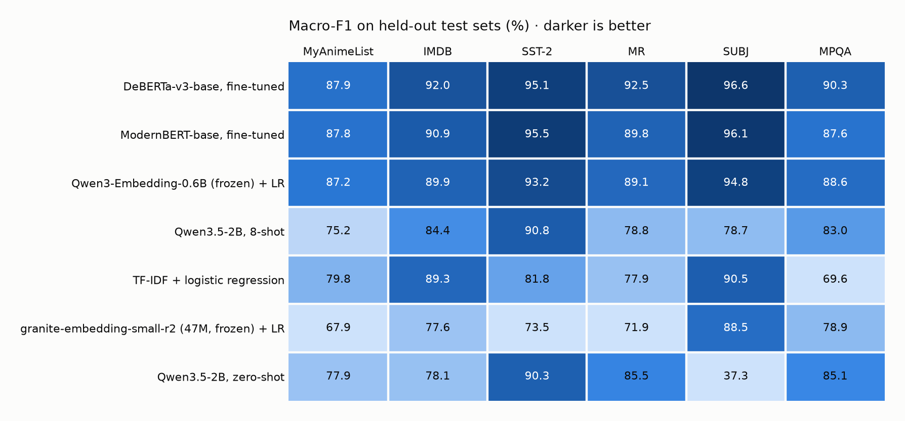
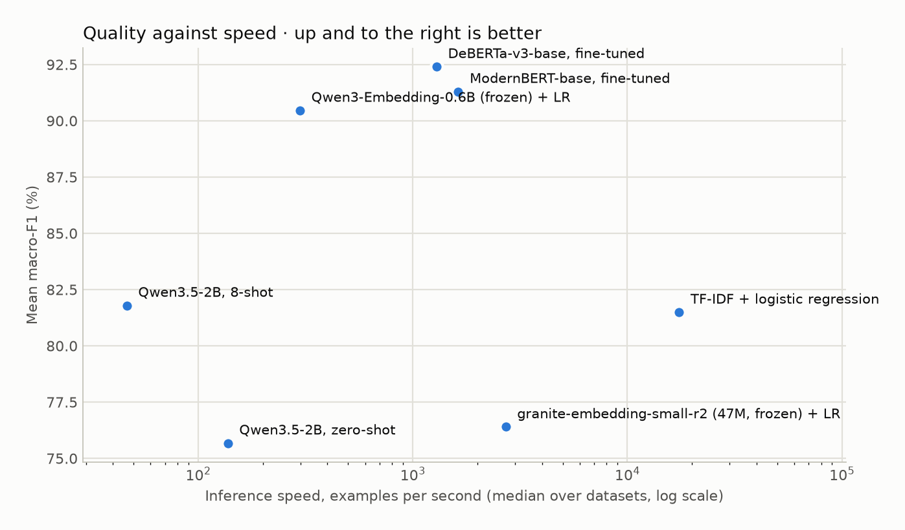
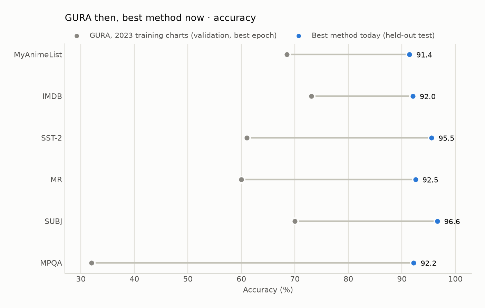

### Leaderboard: macro-F1 on the held-out test splits (%)

Bold marks the best score per dataset. Macro-F1 averages the F1 of both classes, so a model cannot look good by always guessing the bigger class.

| Method | MyAnimeList | IMDB | SST-2 | MR | SUBJ | MPQA | Mean |
| --- | ---: | ---: | ---: | ---: | ---: | ---: | ---: |
| DeBERTa-v3-base, fine-tuned | **87.9** | **92.0** | 95.1 | **92.5** | **96.6** | **90.3** | 92.4 |
| ModernBERT-base, fine-tuned | 87.8 | 90.9 | **95.5** | 89.8 | 96.1 | 87.6 | 91.3 |
| Qwen3-Embedding-0.6B (frozen) + LR | 87.2 | 89.9 | 93.2 | 89.1 | 94.8 | 88.6 | 90.5 |
| Qwen3.5-2B, 8-shot | 75.2 | 84.4 | 90.8 | 78.8 | 78.7 | 83.0 | 81.8 |
| TF-IDF + logistic regression | 79.8 | 89.3 | 81.8 | 77.9 | 90.5 | 69.6 | 81.5 |
| granite-embedding-small-r2 (47M, frozen) + LR | 67.9 | 77.6 | 73.5 | 71.9 | 88.5 | 78.9 | 76.4 |
| Qwen3.5-2B, zero-shot | 77.9 | 78.1 | 90.3 | 85.5 | 37.3 | 85.1 | 75.7 |

<picture>
  <source media="(prefers-color-scheme: dark)" srcset="../docs/images/leaderboard-dark.png">
  
</picture>

### Accuracy (%)

| Method | MyAnimeList | IMDB | SST-2 | MR | SUBJ | MPQA | Mean |
| --- | ---: | ---: | ---: | ---: | ---: | ---: | ---: |
| DeBERTa-v3-base, fine-tuned | **91.4** | **92.0** | 95.1 | **92.5** | **96.6** | **92.2** | 93.3 |
| ModernBERT-base, fine-tuned | 91.3 | 90.9 | **95.5** | 89.8 | 96.2 | 90.1 | 92.3 |
| Qwen3-Embedding-0.6B (frozen) + LR | 90.8 | 89.9 | 93.2 | 89.1 | 94.8 | 90.9 | 91.5 |
| Qwen3.5-2B, 8-shot | 77.6 | 84.4 | 90.8 | 79.5 | 78.7 | 84.8 | 82.6 |
| TF-IDF + logistic regression | 86.9 | 89.3 | 81.9 | 77.9 | 90.5 | 78.0 | 84.1 |
| granite-embedding-small-r2 (47M, frozen) + LR | 80.7 | 77.6 | 73.6 | 71.9 | 88.5 | 83.8 | 79.3 |
| Qwen3.5-2B, zero-shot | 80.6 | 78.7 | 90.3 | 85.5 | 51.8 | 88.0 | 79.2 |

### What it costs

| Method | Parameters | Training (all sets) | Inference, examples/s (median) | Peak VRAM |
| --- | ---: | ---: | ---: | ---: |
| DeBERTa-v3-base, fine-tuned | 184.4M | 34.2 min | 1,289 | 7.4 GB |
| ModernBERT-base, fine-tuned | 149.6M | 25.0 min | 1,629 | 6.9 GB |
| Qwen3-Embedding-0.6B (frozen) + LR | 595.8M | 10.2 min | 298 | 3.3 GB |
| Qwen3.5-2B, 8-shot | 1.9B | none | 46 | 5.1 GB |
| TF-IDF + logistic regression | 200K | 1.9 min | 17,420 | CPU only |
| granite-embedding-small-r2 (47M, frozen) + LR | 47.7M | 1.4 min | 2,709 | 0.6 GB |
| Qwen3.5-2B, zero-shot | 1.9B | none | 137 | 5.0 GB |

<picture>
  <source media="(prefers-color-scheme: dark)" srcset="../docs/images/speed-vs-quality-dark.png">
  
</picture>

### GURA, for the record

GURA (2019, BiGRU + self-attention on GloVe vectors, Keras) is kept here as history, not as a competitor. Its numbers are validation accuracy at the best epoch, on validation sets that mixed in the test split, after re-training until a target was hit, so they are optimistic and not comparable with the held-out test scores above. The 2019 claim comes from a commit message; the 2023 values are read off the training charts in GURA's README (about one point of reading error). The MyAnimeList column used the summarised `myanimelist-sts` text, not the full reviews.

| Dataset | GURA 2019 claim | GURA 2023 charts | Best now, test accuracy |
| --- | ---: | ---: | --- |
| MyAnimeList | – | ≈ 68 | 91.4 (DeBERTa-v3-base, fine-tuned) |
| IMDB | 89.1 | ≈ 73 | 92.0 (DeBERTa-v3-base, fine-tuned) |
| SST-2 | – | ≈ 61 | 95.5 (ModernBERT-base, fine-tuned) |
| MR | – | ≈ 60 | 92.5 (DeBERTa-v3-base, fine-tuned) |
| SUBJ | – | ≈ 70 | 96.6 (DeBERTa-v3-base, fine-tuned) |
| MPQA | – | ≈ 32 | 92.2 (DeBERTa-v3-base, fine-tuned) |

<picture>
  <source media="(prefers-color-scheme: dark)" srcset="../docs/images/gura-then-now-dark.png">
  
</picture>

### Per-dataset breakdown

#### MyAnimeList reviews (MALCoD)

25,000 train / 2,000 val / 5,000 test; labels: negative / positive.

| Method | Accuracy | Macro-F1 | 95% CI (F1) | Training | Examples/s |
| --- | ---: | ---: | ---: | ---: | ---: |
| DeBERTa-v3-base, fine-tuned | 91.4 | 87.9 | 86.8–89.0 | 15.1 min | 238 |
| ModernBERT-base, fine-tuned | 91.3 | 87.8 | 86.5–88.9 | 10.3 min | 177 |
| Qwen3-Embedding-0.6B (frozen) + LR | 90.8 | 87.2 | 86.0–88.3 | 5.1 min | 82 |
| TF-IDF + logistic regression | 86.9 | 79.8 | 78.5–81.2 | 1.4 min | 822 |
| Qwen3.5-2B, zero-shot | 80.6 | 77.9 | 76.6–79.0 | none | 33 |
| Qwen3.5-2B, 8-shot | 77.6 | 75.2 | 73.9–76.3 | none | 11 |
| granite-embedding-small-r2 (47M, frozen) + LR | 80.7 | 67.9 | 66.2–69.5 | 46 s | 621 |

#### IMDB movie reviews (aclImdb)

22,901 train / 2,000 val / 5,000 test; labels: negative / positive.

| Method | Accuracy | Macro-F1 | 95% CI (F1) | Training | Examples/s |
| --- | ---: | ---: | ---: | ---: | ---: |
| DeBERTa-v3-base, fine-tuned | 92.0 | 92.0 | 91.3–92.8 | 6.3 min | 831 |
| ModernBERT-base, fine-tuned | 90.9 | 90.9 | 90.1–91.7 | 6.4 min | 383 |
| Qwen3-Embedding-0.6B (frozen) + LR | 89.9 | 89.9 | 89.1–90.7 | 2.2 min | 200 |
| TF-IDF + logistic regression | 89.3 | 89.3 | 88.5–90.1 | 26 s | 2,984 |
| Qwen3.5-2B, 8-shot | 84.4 | 84.4 | 83.4–85.3 | none | 15 |
| Qwen3.5-2B, zero-shot | 78.7 | 78.1 | 76.9–79.2 | none | 86 |
| granite-embedding-small-r2 (47M, frozen) + LR | 77.6 | 77.6 | 76.5–78.8 | 19 s | 1,646 |

#### Stanford Sentiment Treebank, binary (SST-2)

25,000 train / 872 val / 1,819 test; labels: negative / positive.

| Method | Accuracy | Macro-F1 | 95% CI (F1) | Training | Examples/s |
| --- | ---: | ---: | ---: | ---: | ---: |
| ModernBERT-base, fine-tuned | 95.5 | 95.5 | 94.6–96.4 | 4.8 min | 2,022 |
| DeBERTa-v3-base, fine-tuned | 95.1 | 95.1 | 94.1–96.0 | 6.0 min | 1,749 |
| Qwen3-Embedding-0.6B (frozen) + LR | 93.2 | 93.2 | 92.1–94.3 | 1.6 min | 289 |
| Qwen3.5-2B, 8-shot | 90.8 | 90.8 | 89.6–92.1 | none | 66 |
| Qwen3.5-2B, zero-shot | 90.3 | 90.3 | 88.9–91.6 | none | 203 |
| TF-IDF + logistic regression | 81.9 | 81.8 | 80.0–83.5 | 2 s | 18,924 |
| granite-embedding-small-r2 (47M, frozen) + LR | 73.6 | 73.5 | 71.5–75.6 | 9 s | 2,493 |

#### Movie Review sentence polarity (MR)

7,677 train / 853 val / 2,132 test; labels: negative / positive.

| Method | Accuracy | Macro-F1 | 95% CI (F1) | Training | Examples/s |
| --- | ---: | ---: | ---: | ---: | ---: |
| DeBERTa-v3-base, fine-tuned | 92.5 | 92.5 | 91.4–93.6 | 1.8 min | 1,748 |
| ModernBERT-base, fine-tuned | 89.8 | 89.8 | 88.5–91.0 | 1.1 min | 2,633 |
| Qwen3-Embedding-0.6B (frozen) + LR | 89.1 | 89.1 | 87.9–90.4 | 21 s | 754 |
| Qwen3.5-2B, zero-shot | 85.5 | 85.5 | 84.0–86.9 | none | 204 |
| Qwen3.5-2B, 8-shot | 79.5 | 78.8 | 77.2–80.5 | none | 53 |
| TF-IDF + logistic regression | 77.9 | 77.9 | 76.1–79.7 | 1 s | 22,524 |
| granite-embedding-small-r2 (47M, frozen) + LR | 71.9 | 71.9 | 70.0–73.7 | 3 s | 3,153 |

#### Subjectivity (SUBJ)

7,200 train / 800 val / 2,000 test; labels: subjective / objective.

| Method | Accuracy | Macro-F1 | 95% CI (F1) | Training | Examples/s |
| --- | ---: | ---: | ---: | ---: | ---: |
| DeBERTa-v3-base, fine-tuned | 96.6 | 96.6 | 95.7–97.4 | 1.7 min | 1,777 |
| ModernBERT-base, fine-tuned | 96.2 | 96.1 | 95.2–96.9 | 57 s | 2,548 |
| Qwen3-Embedding-0.6B (frozen) + LR | 94.8 | 94.8 | 93.7–95.7 | 26 s | 306 |
| TF-IDF + logistic regression | 90.5 | 90.5 | 89.1–91.7 | 2 s | 15,917 |
| granite-embedding-small-r2 (47M, frozen) + LR | 88.5 | 88.5 | 87.2–89.8 | 3 s | 2,925 |
| Qwen3.5-2B, 8-shot | 78.7 | 78.7 | 76.9–80.4 | none | 40 |
| Qwen3.5-2B, zero-shot | 51.8 | 37.3 | 35.8–39.0 | none | 183 |

#### MPQA opinion polarity

5,863 train / 651 val / 1,628 test; labels: negative / positive.

| Method | Accuracy | Macro-F1 | 95% CI (F1) | Training | Examples/s |
| --- | ---: | ---: | ---: | ---: | ---: |
| DeBERTa-v3-base, fine-tuned | 92.2 | 90.3 | 88.7–91.8 | 3.3 min | 521 |
| Qwen3-Embedding-0.6B (frozen) + LR | 90.9 | 88.6 | 86.8–90.3 | 26 s | 372 |
| ModernBERT-base, fine-tuned | 90.1 | 87.6 | 85.8–89.4 | 1.4 min | 1,236 |
| Qwen3.5-2B, zero-shot | 88.0 | 85.1 | 83.1–87.0 | none | 92 |
| Qwen3.5-2B, 8-shot | 84.8 | 83.0 | 80.9–84.9 | none | 64 |
| granite-embedding-small-r2 (47M, frozen) + LR | 83.8 | 78.9 | 76.5–81.1 | 2 s | 3,055 |
| TF-IDF + logistic regression | 78.0 | 69.6 | 67.1–72.3 | 0 s | 54,548 |
